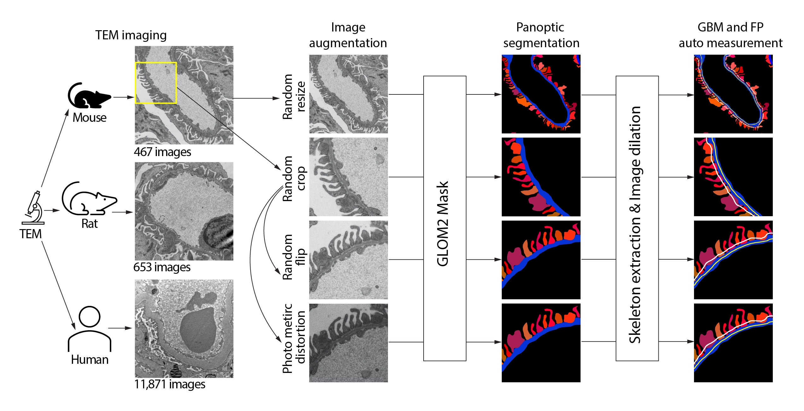
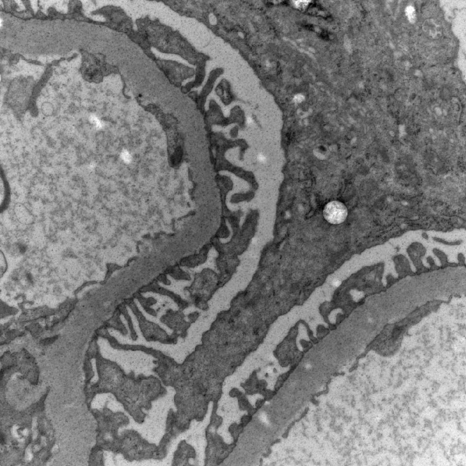
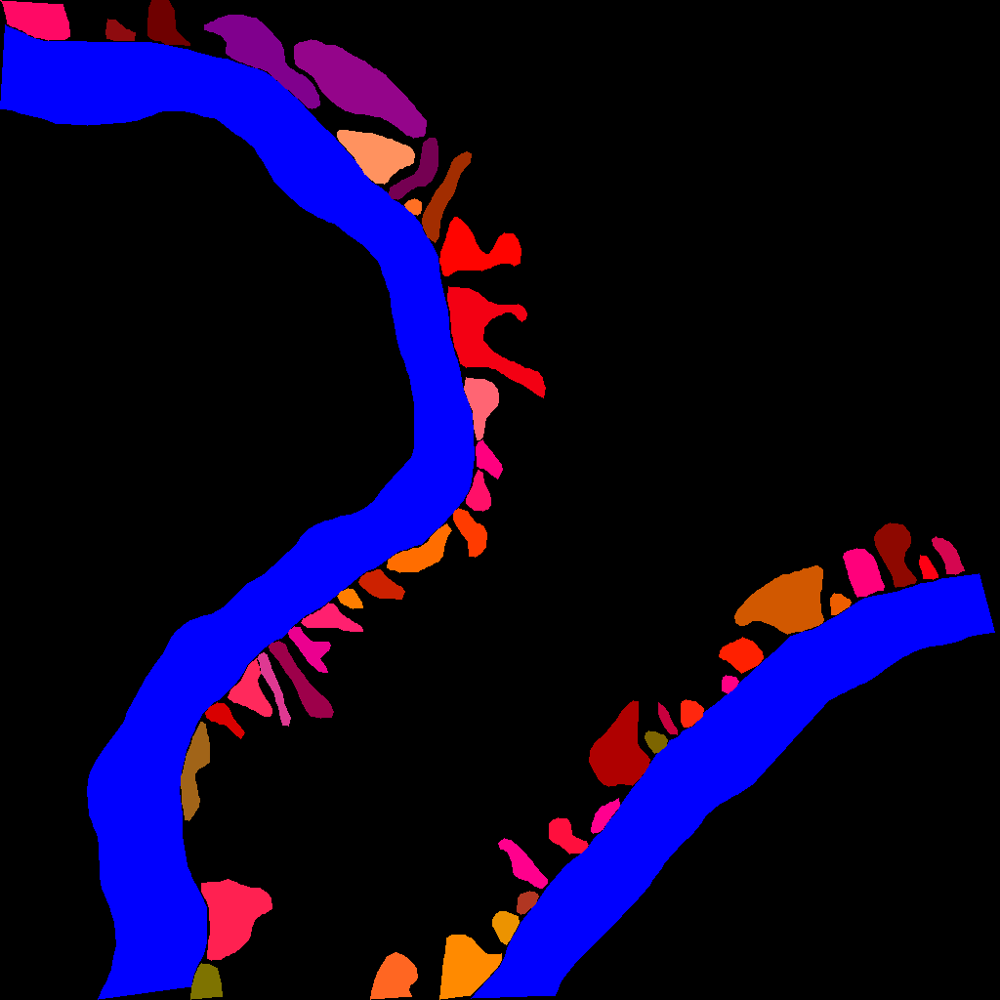
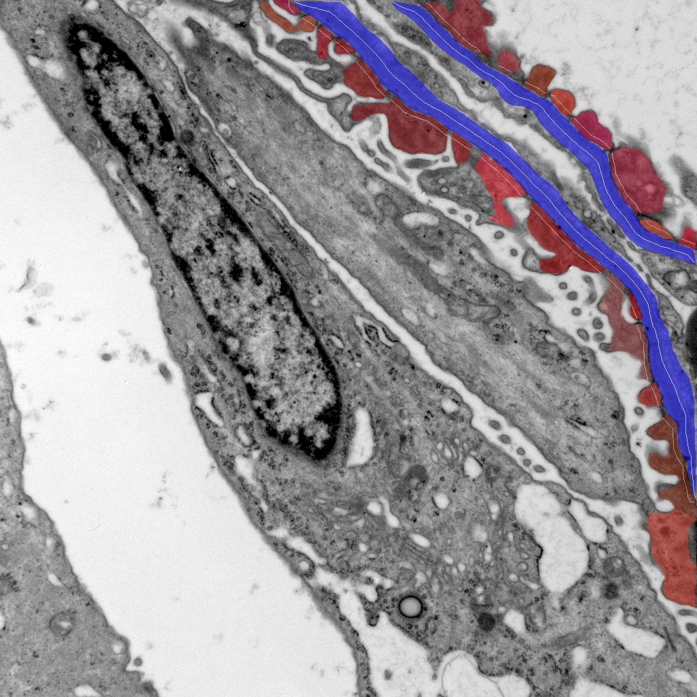
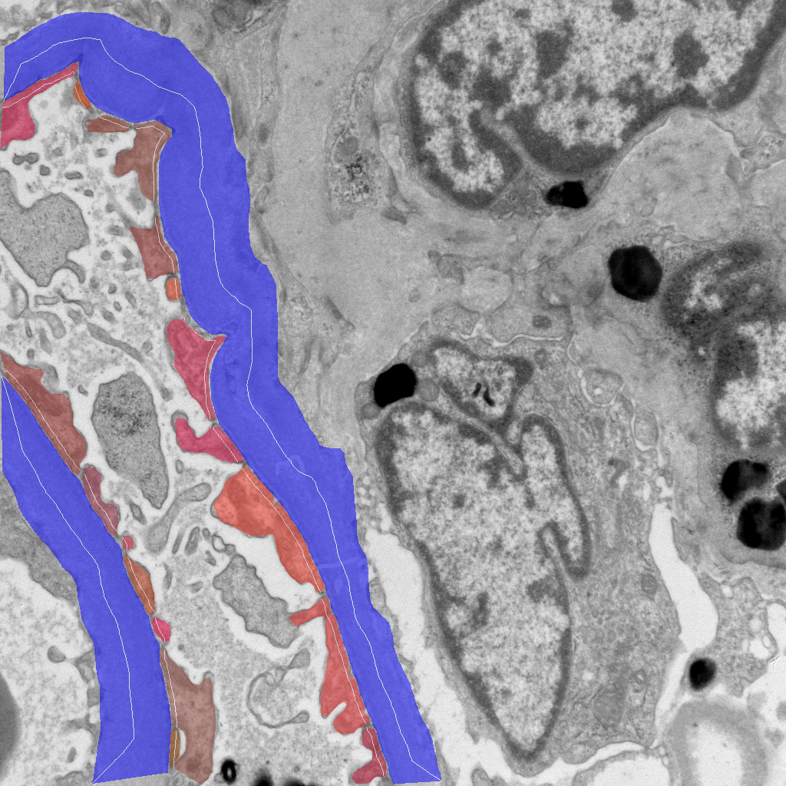
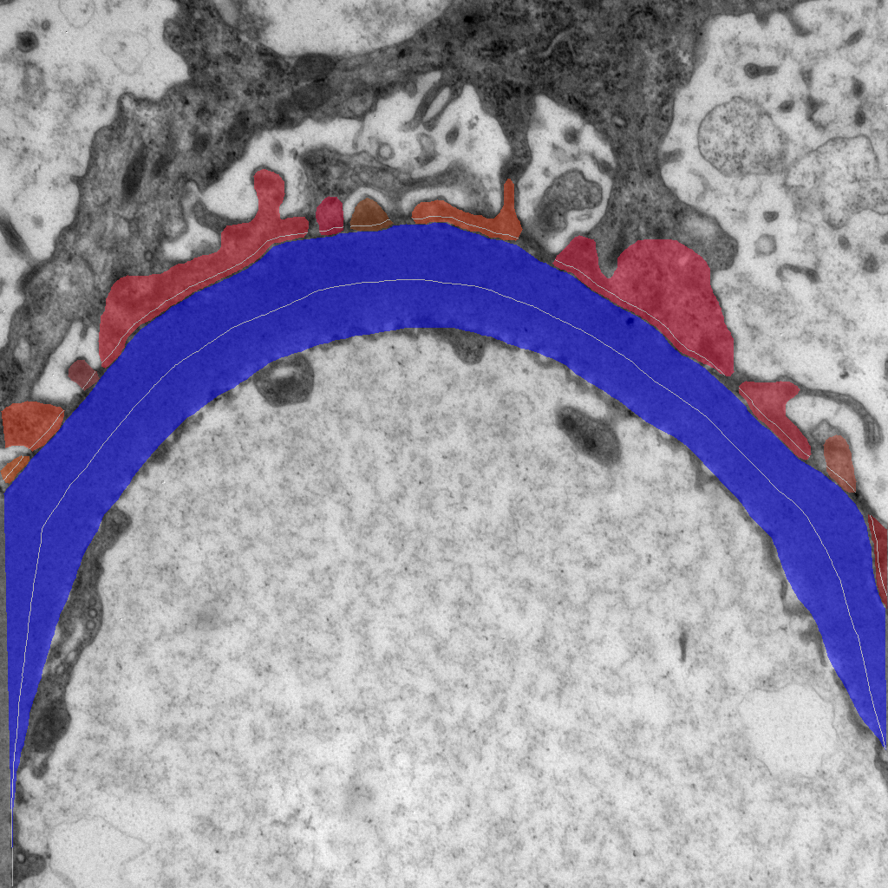

# Kidney TEM Panoptic Segmentation & Measurement Pipeline

This repository provides the official implementation of the method described in the paper:

**“Deep Learning Enables Automated Segmentation and Quantification of Ultrastructure from Transmission Electron Microscopy Images”**

📄 Paper: https://www.biorxiv.org/content/10.1101/2025.11.05.686793v2

This work presents an automated deep learning-based framework for accurate and scalable segmentation and quantification of kidney ultrastructures, including glomerular basement membrane (GBM) and podocyte foot processes (FP), from transmission electron microscopy (TEM) images. :contentReference[oaicite:0]{index=0}  

---

## 📌 Overview

This project implements a two-stage pipeline for automated ultrastructure analysis from TEM images.

---

## 🔬 Pipeline Overview

<p align="center">
  
</p>


### 1️⃣ Panoptic Segmentation (Deep Learning)
- Model: GLOM2Mask
- Input: TEM images
- Output:
  - Labelme JSON (polygon annotations)
  - Visualization images
  - Optional raw outputs (pkl)

### 2️⃣ Measurement Extraction (Post-processing)
- Input: segmentation JSON + original images
- Output:
  - GBM width
  - FP width
  - Skeleton length
  - Area
  - CSV summary
  - Visualization overlays

---

## 📂 Project Structure  
```
.  
├── data/                        # Dataset directory   
│   └── images/                  # Input TEM images   
│   
├── mytools/                     # Core pipeline scripts   
│   ├── segmentation.py          # Step 1: Panoptic segmentation (Mask2Former)   
│   └── measurement.py           # Step 2: GBM & FP measurement   
│   
├── myconfigs/                   # Model configuration files   
├── models/                      # Pretrained model checkpoints   
├── mmdet/                       # MMDetection source code   
├── requirements/                # Dependency files   
├── results/                     # Output directory   
├── examples/                    # Example images   
│   └── workflow.jpg   
└── README.md   
```
---

## ⚙️ Installation

### Requirements
- Python >= 3.8  
- CUDA >= 11.8  

### 1. Create environment
conda create -n kidney_pipeline python=3.8  
conda activate kidney_pipeline  

### 2. Install PyTorch
pip install torch torchvision --index-url https://download.pytorch.org/whl/cu118  

### 3. Install dependencies
pip install -r requirements.txt  

### 4. Install TEAMKidney (source)
git clone https://github.com/CZCBLab/TEAMKidney.git  
cd TEAMKidney  
pip install -v -e .  

### 🔹 5. Install OpenMMLab Dependencies

This project relies on core OpenMMLab libraries for model inference, including:

- **mmcv**
- **mmengine**

⚠️ These dependencies have strict compatibility requirements with PyTorch and CUDA versions.

We recommend installing them by following the official MMDetection installation guide to ensure proper version matching:

- Official MMDetection GitHub:
  👉 https://github.com/open-mmlab/mmdetection

## 🚀 Usage

### 📦 Pretrained Models

We provide pretrained model weights for GBM and FP segmentation.

👉 [Download pretrained models from Google Drive](https://drive.google.com/file/d/1nO5gpz3ch6-Axt_vTQky0Qs0QdIvHYcz/view?usp=drive_link)

Please download the checkpoints and place them into the ./models directory:


### Step 1: Segmentation

python segmentation.py \
  --config-file configs/your_config.py \
  --checkpoint-file checkpoints/model.pth \
  --imgpath /path/to/images \
  --json-path /output/json \
  --outim-path /output/vis \
  --savejson \
  --ifshow  

### 🔍 Example: Input vs Segmentation Output

<div align="center">

<table>
<tr>
<td align="center"><b>Input TEM Image</b></td>
<td align="center"><b>Panoptic Segmentation Output</b></td>
</tr>
<tr>
<td></td>
<td></td>
</tr>
</table>

</div>

The segmentation model identifies:
- **GBM (Glomerular Basement Membrane)** as continuous structures  
- **FP (Foot Processes)** as instance-level segmented regions  

The output visualization (`outim`) provides a clear structural separation for downstream quantitative analysis.

---

### Step 2: Measurement

python measurement.py \
  --image-path /path/to/images \
  --seg-path /output/json \
  --out-csv /output/measurements.csv \
  --out-seg-path /output/measurements_vis \
  --out-fp-json /output/fp_widths.json \
  --pixelsize 4.122 \
  --sdheight 20  

### 📏 Example: Measurement Visualization

<div align="center">

<table>
<tr>
<td align="center"><b>Example 1</b></td>
<td align="center"><b>Example 2</b></td>
<td align="center"><b>Example 3</b></td>
</tr>
<tr>
<td></td>
<td></td>
<td></td>
</tr>
</table>

</div>

The measurement module provides visualization outputs for quality control and debugging:

- **GBM skeleton (blue region with centerline)** is extracted to represent the structural backbone of the glomerular basement membrane.
- **FP (Foot Process) width measurement locations** are highlighted along the GBM boundary.
- The overlaid visualization shows:
  - Measurement trajectories
  - Local width estimation positions
  - Structural alignment between GBM and FP

These visualizations are useful for:
- ✅ Verifying segmentation correctness  
- ✅ Inspecting measurement accuracy  
- ✅ Debugging parameter settings  
- ✅ Validating biological plausibility of results  

---

## 📊 Outputs

- measurements.csv → quantitative results  
- fp_widths.json → FP width distribution  
- visualization images  

---

## 📜 Citation

If you use this code, please cite:

```bibtex
@article{zou2026tem,
  title={Deep Learning Enables Automated Segmentation and Quantification of Ultrastructure from Transmission Electron Microscopy Images},
  	author = {Zou, Anqi and Tan, Winston and Ji, Jiayi and Rojas-Miguez, Florencia and Dodd, Laura and Oei, Emily and Vargas, Sarah R. and Yang, Hongying and Berasi, Stephen P. and Chen, Hui and Henderson, Joel M. and Fan, Xueping and Lu, Weining and Zhang, Chao},
  journal={bioRxiv},
  year={2026},
  doi={10.1101/2025.11.05.686793}
}
```

---

## 🙏 Acknowledgements

This project builds upon several excellent open-source projects:

- **MMDetection**  
  We thank the authors of MMDetection for providing a powerful and flexible object detection and segmentation framework.  
  GitHub: https://github.com/open-mmlab/mmdetection

- **fpw-dl-v1 (Najafian Lab)**  
  We acknowledge the work by Najafian Lab on foot process width measurement, which inspired parts of the quantitative analysis in this project.  
  GitHub: https://github.com/najafian-lab/fpw-dl-v1

We sincerely appreciate the contributions of these open-source communities.
